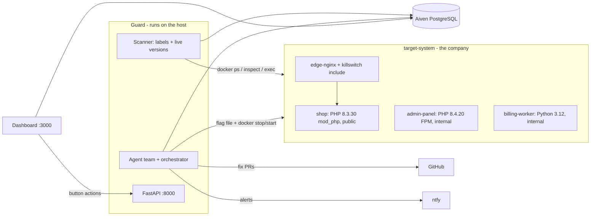
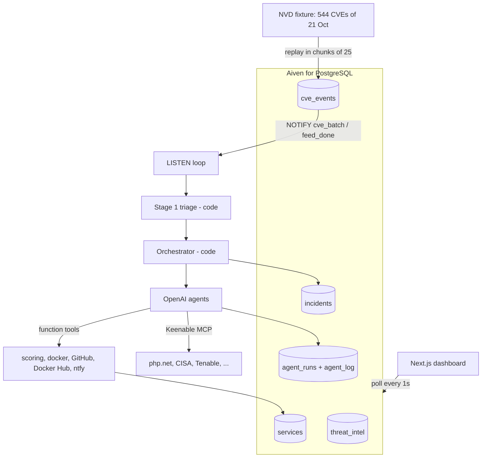
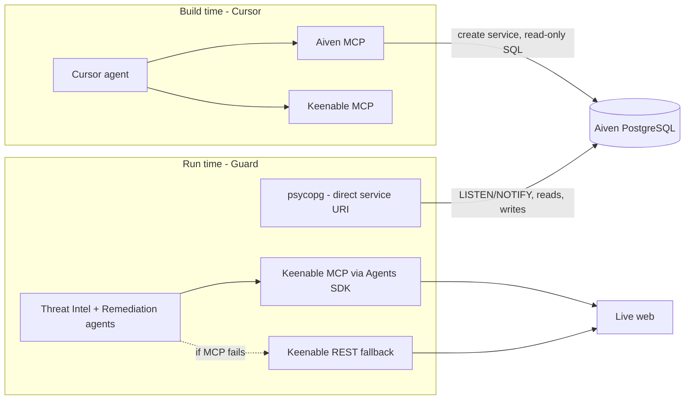
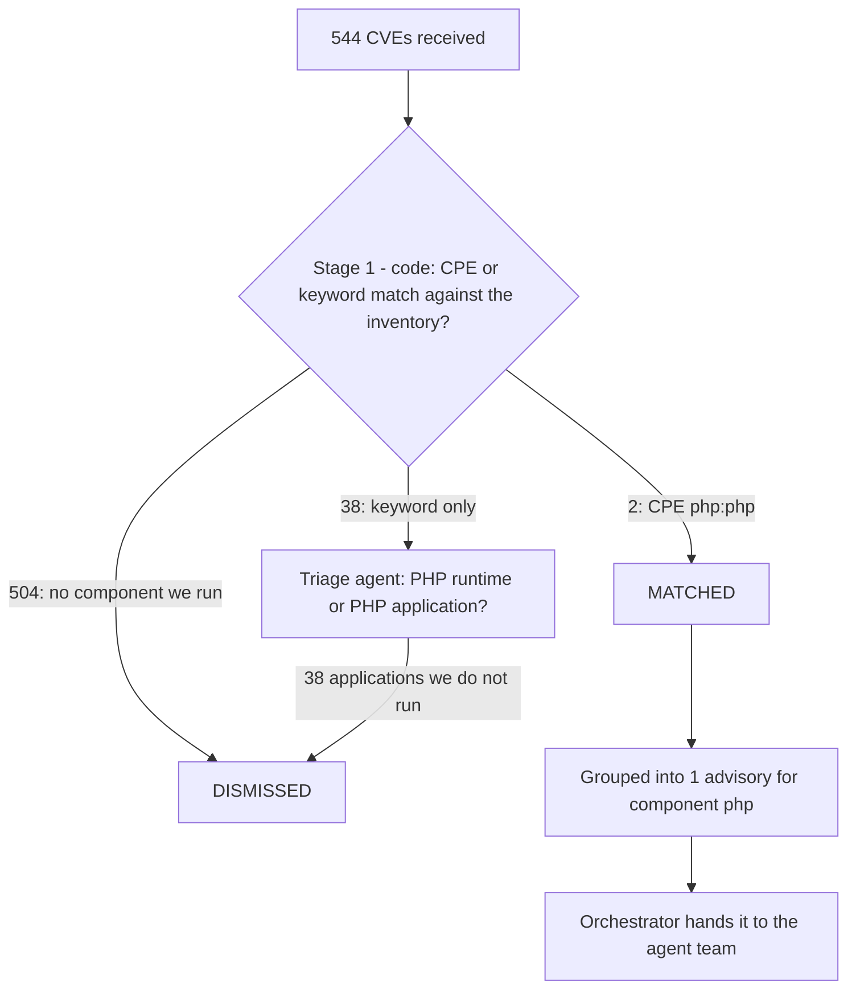
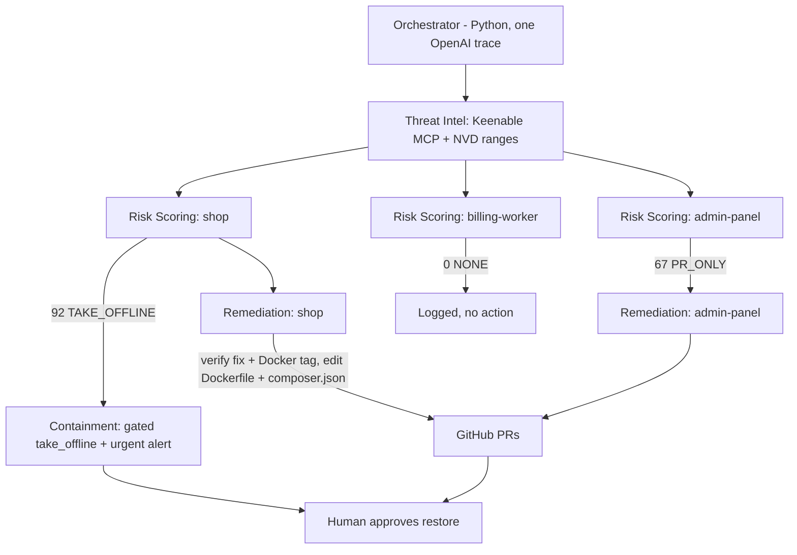
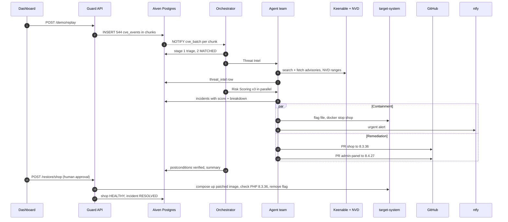
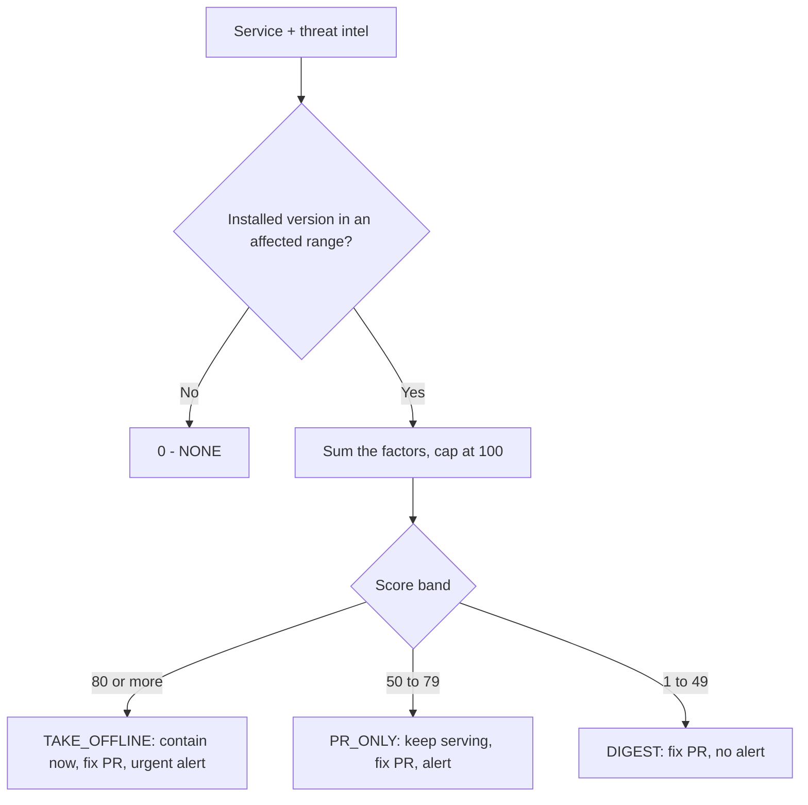
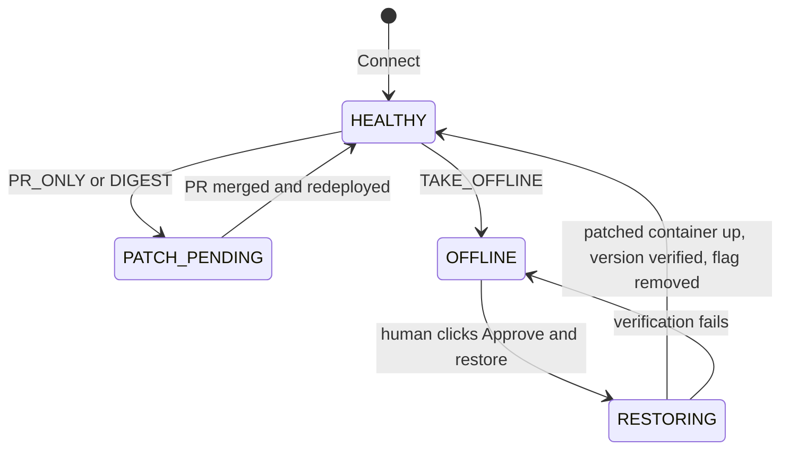
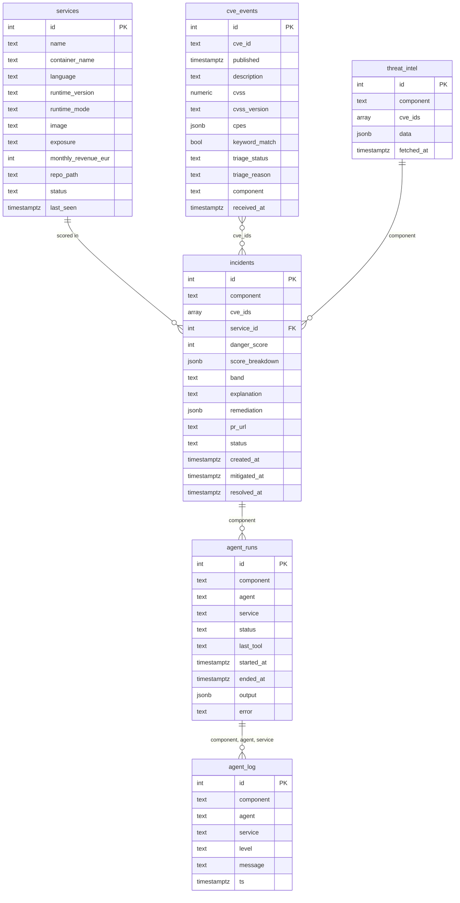

# Guard architecture

Guard plugs into a running system, reads the CVE feed, and lets a team of OpenAI agents decide, per service, what a new vulnerability actually means. The demo uses **PHP2Shell** (CVE-2026-109618 and CVE-2026-109619, disclosed 21 October 2026): unauthenticated RCE in PHP up to 8.5.11, fixed in 8.5.12, 8.4.27, 8.3.36 and 8.2.35, with no official release for 8.1 and older.

Sources: [CISA alert](https://www.cisa.gov/news-events/alerts/2026/10/21/critical-vulnerabilities-php-require-immediate-patching), [PHP Foundation](https://thephp.foundation/blog/2026/10/21/todays-php-security-release-and-how-were-strengthening-php-security/), [Tenable FAQ](https://www.tenable.com/blog/php2shell-cve-2026-109618-cve-2026-109619-frequently-asked-questions-about-critical-php-remote).

The feed is real: `sentinel/fixtures/nvd-2026-10-21.json` is the NVD API dump of all 544 CVEs published that day. Only 2 of them carry CPE data (both `cpe:2.3:a:php:php`), and 40 mention "PHP" in the description, so a keyword script would have paged the team 40 times.

## 1. How Guard plugs in

The protected system (`target-system/`) knows nothing about Guard except four touch points:

1. **Container labels**: `sentinel.service`, `sentinel.language`, `sentinel.exposure`, `sentinel.revenue`, `sentinel.repo_path`, `sentinel.runtime_mode`. The live runtime version is detected, not declared.
2. **One Nginx include** per route: `include /etc/nginx/sentinel/killswitch.conf;` serves the maintenance page while `runtime/flags/<service>.flag` exists.
3. **Docker access** on the host, where the Guard agent runs.
4. **A GitHub token** for the repository that builds the system.

## 2. System overview

Everything Guard knows or decides is a row in one Aiven for PostgreSQL service: the inventory, the CVE feed and its triage, the threat intel, the incidents with their scores, and every agent step. Postgres is also the event bus: inserting CVEs fires `pg_notify`, which wakes the agent.

## 3. Where the MCP servers fit

- Aiven MCP is used from Cursor to create the service and inspect it. Its SQL is read-only, so the schema is applied with `psql`.
- Keenable MCP is used both from Cursor and **at run time** by the Threat Intel and Remediation agents (`MCPServerStreamableHttp`, tools `search_web_pages` and `fetch_page_content`), with the Keenable REST API as fallback.

## 4. Feed funnel

## 5. The agent team

Code orchestrates; agents research, explain and act through narrow tools. Each agent has a Pydantic output type and its own lane on the dashboard.

- **Triage** (fast model, once per feed): classifies the 38 keyword-only CVEs. No tools.
- **Threat Intel** (smart model, once per advisory): `search_web_pages`, `fetch_page_content`, `get_nvd_ranges`. Returns CVSS, exploitation evidence, high-risk runtime modes, fixed version per branch with a source each, unsupported branches, conflicts (CISA "not observed" vs Amazon/Tenable "exploited").
- **Risk Scoring** (fast model, one run per service, in parallel): `get_service`, `compute_danger_score`. The tool computes and persists the number; the agent explains it in business terms.
- **Containment** (fast model, for TAKE_OFFLINE): `take_offline` refuses unless the persisted score is at least 80; `send_alert`.
- **Remediation** (smart model, one run per affected service, in parallel with Containment): Keenable to confirm the official release, `check_docker_tag`, `read_repo_file`, `open_fix_pr` (path allowlist = the service folder, never merges). No official fix for the branch means an upgrade PR marked as a breaking change.

After the agents finish, the orchestrator verifies postconditions (the service really is offline, fixes are recorded) and calls the tools itself if an agent skipped a step.

## 6. One incident, end to end

## 7. Danger score

Deterministic, inside `compute_danger_score`; zero unless the installed version is in an affected range.

- Severity: CVSS x 4, max 40. PHP2Shell uses its CVSS v4.0 score, 9.2, giving 36.8.
- Exploitation reported by any credible source: +20.
- Exposure: public +20, internal +5.
- Runtime mode named high-risk by the advisory (mod_php, `apache2handler`): +10, other +5.
- Revenue of 10,000 EUR/month or more: +5.
- No official fix for the installed branch (PHP 8.1 and older): +15.

Results: **shop 92** (36.8 + 20 + 20 + 10 + 5), **admin-panel 67** (36.8 + 20 + 5 + 5), **billing-worker 0**.

## 8. Fallback mode

Every lane can finish without its agent. With no `OPENAI_API_KEY`, or when an agent errors or skips its job, code does the same work and the lane is marked `cached` or `failed`:

- Triage: rule "a runtime CVE's description starts with the runtime's own name, `PHP `".
- Threat Intel: cached `threat_intel` row, then `fixtures/php2shell-intel.json`.
- Risk Scoring: the score tool called directly, template explanation.
- Containment and Remediation: the same tools called by code.

Missing GitHub or ntfy configuration is logged as a warning and skipped.

## 9. Service lifecycle

## 10. Data model

The `feed_funnel` view aggregates `cve_events` for the dashboard (total, keyword hits, candidates, dismissed, matched).

## 11. Safety design

- Agents act only through tools; the destructive tool re-checks the persisted, deterministic score.
- The PR tool only edits files inside the service's own folder and never merges.
- Every agent output is schema-validated; the orchestrator verifies postconditions and falls back to code.
- Taking a service offline keeps its container and data (stop, not delete) and puts a maintenance page in front of it; a human approves the restore.
- In production the agent's Docker access would go through a restricted socket proxy instead of the host socket.
